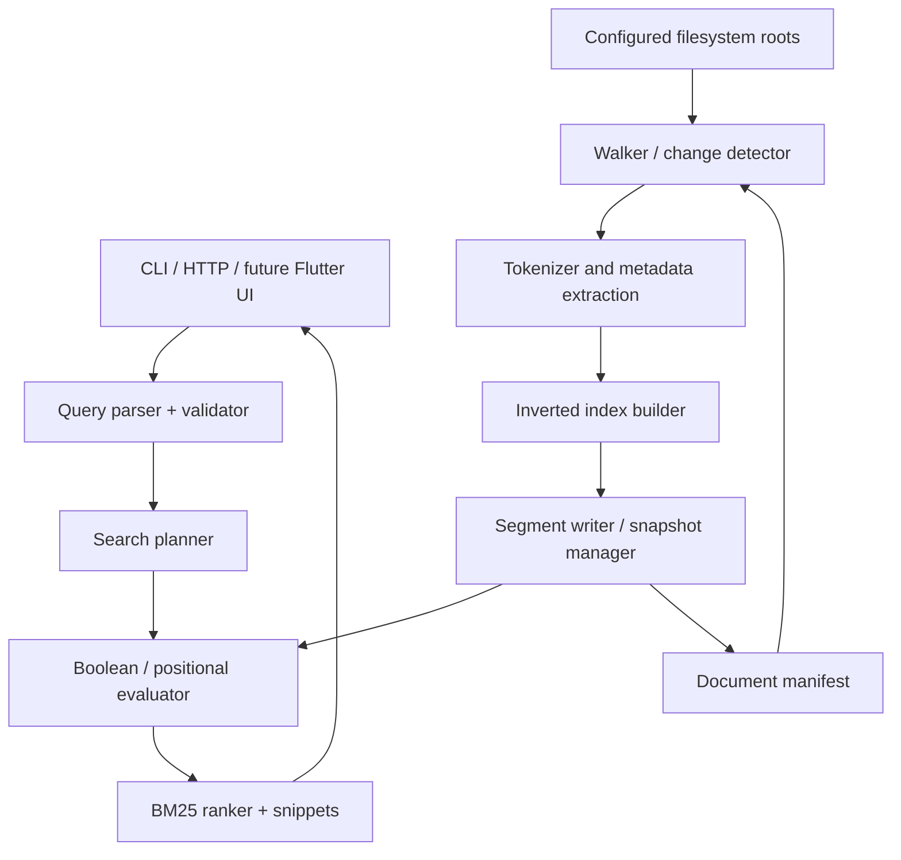

# FerrisFind — Rust Search & Indexing Engine

**Version:** 1.0 · **Status:** Design / learning roadmap · **Language:** Rust (2024 edition)  
**Primary deliverable:** Cross-platform CLI search engine; optional HTTP service and Flutter desktop frontend.  
**Audience:** An experienced software engineer learning Rust from *The Rust Programming Language*.  
**Guiding principle:** Implement foundational algorithms yourself first; integrate mature crates where they solve infrastructure rather than hide the learning objective.

---

## 1. Executive summary

FerrisFind indexes local text files and answers queries quickly using a persistent **inverted index**. It starts as an unindexed `grep`-style command, evolves into a deterministic indexed CLI, then adds incremental updates, filesystem watching, parallel indexing, an HTTP service, performance work, and optional Rust FFI/WebAssembly adapters.

The project is intended to exercise Rust's ownership and borrowing, enums, error handling, traits, lifetimes, iterators, collections, threads, channels, `Send`/`Sync`, async, I/O, serialization, testing, profiling and—only where justified—unsafe boundaries.

### 1.1 Learning goals

By the end, be able to:

1. Design APIs around `&str`, `Path`, `PathBuf`, slices, ownership, borrowing and explicit error types.
2. Explain when to use `Box`, `Rc`, `Arc`, `Mutex`, `RwLock`, channels and atomics.
3. Design and implement a correct tokenizer, inverted index, query parser and ranking pipeline.
4. Handle data races, cancellation, backpressure and failure recovery without corrupting an index.
5. Quantify runtime and memory tradeoffs through reproducible benchmarks.
6. Publish a well-tested Rust library used from a CLI, an HTTP API and optionally Flutter.

### 1.2 Product goals

- Index explicitly configured roots and find file content by keyword, phrase and Boolean query.
- Return file path, optional line number, text snippet, score and highlights.
- Filter by extension, path glob, file size and update time.
- Support deterministic incremental reindexing and deletes.
- Run on macOS, Linux and Windows where practical.
- Operate safely on untrusted local file contents; serving over the network requires explicit opt-in and security controls.

### 1.3 Deliberate non-goals

- Full web search, distributed consensus, semantic vector search or embeddings.
- Indexing arbitrary formats (PDF, DOCX, images) in the core MVP.
- Perfect language-aware stemming for all languages, or guaranteed substring search.
- Replacing ripgrep for raw regex search or a production search engine on the first iteration.
- Following symbolic links by default, or silently opening files outside configured roots.

---

## 2. User stories and acceptance criteria

| ID | User story | Acceptance criteria |
|---|---|---|
| US-01 | Search a directory without an index | Finds matching lines; returns meaningful exit codes and readable errors. |
| US-02 | Build an index once | Re-running an identical query against unchanged files produces identical ranked results. |
| US-03 | Search keyword(s) | Returns documents containing terms using configurable AND/OR semantics. |
| US-04 | Search phrase | Matches only adjacent tokens in the same indexed field; uses positions. |
| US-05 | Filter search | Limits by extension, root and path without escaping permitted roots. |
| US-06 | Update the index | Add/edit/delete/rename changes become reflected; stale records removed. |
| US-07 | Handle failures | Unreadable, deleted, binary or malformed files do not crash the process. |
| US-08 | Search from HTTP | Concurrent local clients get results within configured limits. |
| US-09 | Reopen persisted index | Crash-safe committed snapshots can reopen or recover. |
| US-10 | Measure performance | Reports throughput, index size, memory usage, p50/p95 latency and comparison baselines. |

**Definition of done per feature:** unit tests + integration tests + documented semantics + `cargo fmt --check` + `cargo clippy -- -D warnings` + `cargo test` (adjust workspace flags later).

---

## 3. Functional specification

### 3.1 Proposed CLI

These commands are the target interface; implement incrementally.

```bash
# Phase 1: scan without index
ferrisfind scan 'TODO' ./src --ext rs --line-number

# Phase 3: create or refresh an index
ferrisfind index ./projects --index-dir ./.ferrisfind

# Search the index (default AND between plain terms)
ferrisfind search 'database connection' --index-dir ./.ferrisfind
ferrisfind search 'database OR cache' --index-dir ./.ferrisfind
ferrisfind search '"database connection"' --index-dir ./.ferrisfind
ferrisfind search 'error AND NOT ignored' --ext rs --limit 20

# Incremental rebuild, diagnostics, inspect
ferrisfind update --index-dir ./.ferrisfind
ferrisfind stats --index-dir ./.ferrisfind
ferrisfind doctor --index-dir ./.ferrisfind

# Phase 4/5: watcher and server
ferrisfind watch ./projects --index-dir ./.ferrisfind
ferrisfind serve --bind 127.0.0.1:8080 --index-dir ./.ferrisfind
```

Recommended exit codes: `0` success (scan has matches), `1` scan has no matches, `2` usage error, `3` IO/index error. Document whether indexed search uses a no-results exit code (prefer `0` with an empty result set for APIs and indexed search).

### 3.2 Query language (explicit semantics)

- Bare words are normalized and matched as **whole tokens**, not substrings.
- Whitespace between terms means `AND` in v1. `OR`, `AND`, `NOT`, parentheses and quoted phrases are added in later phases.
- `AND` has higher precedence than `OR`; unary `NOT` highest. Parentheses override precedence.
- `NOT` is interpreted relative to the visible document universe (configured roots and filters).
- Quoted phrase requires sequential token positions, not merely co-occurrence.
- A token like `database` will not necessarily match `databases` unless explicit stemming is added.
- Empty queries, unclosed quotes, excessive nesting, impossible filters and unsupported syntax return typed errors.
- Path glob and extension filters are applied consistently to the candidate universe; do not permit `NOT` to reveal excluded documents.
- Rankings: exact Boolean matching first; optionally score matching results with BM25.

**Initial ASCII-friendly tokenizer:** split on non-alphanumeric Unicode characters, apply Unicode lowercase, discard empty tokens. Note: Unicode lowercasing is not full case-folding; `char` boundaries and Unicode normalization have subtleties. A later tokenizer version may use ICU/unicode normalization. Persist the tokenizer version with each index and rebuild when it changes.

### 3.3 Output schema

```json
{
  "query": "database connection",
  "index_generation": 12,
  "total_hits": 1,
  "results": [
    {
      "document_id": 42,
      "path": "src/storage.rs",
      "score": 3.58,
      "matched_terms": ["database", "connection"],
      "line": 18,
      "snippet": "... database connection pool ...",
      "highlights": [[4, 12], [13, 23]]
    }
  ]
}
```

**Contract notes:** `highlights` refer to UTF-8 byte ranges in the returned snippet, with exclusive end indices, and must fall on valid UTF-8 boundaries. `total_hits` means exact hit count unless response explicitly flags truncation. `score` is meaningful within one query/index generation, not across unrelated queries. Platform-native file paths may not be UTF-8; the CLI must handle `OsStr` safely, and the JSON API must define a lossless path encoding or explicitly signal lossy display paths.

---

## 4. Architecture and data flow



**Responsibility boundaries**

| Component | Responsibility | Must not own |
|---|---|---|
| `scanner` | Traverse roots, apply traversal policy, stream file data | Search ranking |
| `tokenizer` | Convert content to normalized terms and positions | Filesystem access |
| `indexer` | Allocate document IDs, build/update postings | HTTP concerns |
| `storage` | Commit/load consistent generations | Query interpretation |
| `query` | Parse syntax into AST; validate user inputs | File I/O |
| `search` | Evaluate AST, rank hits, reconstruct snippets | Index writes |
| `watcher` | Translate FS events into change candidates | Assume events are complete/reliable |
| `server` | Authentication/bind policy, limits, API | Business logic in route handlers |

Core libraries should be usable with no Tokio runtime. Use Tokio only in adapter/server layers. CPU-heavy work should use worker threads/Rayon, not occupy async executor threads.

### 4.1 Storage and identity invariants

1. A `DocumentId` is a stable integer **within one index lineage**. If a path's content changes, it keeps its ID; deletion leaves a tombstone until compaction.
2. A path may refer to at most one live document per root; document IDs never silently resolve to a different path.
3. Postings for each `(term, document)` are strictly sorted by position; document IDs are unique and sorted in each postings list.
4. Every read sees **one committed index generation**, never partially updated files.
5. All user-visible search results satisfy both query and filter semantics.
6. A source file's contents may change between scan and read; detect and retry or mark skipped—never report an inconsistent indexed version as current.

---

## 5. Algorithms: required and optional

### 5.1 Recursive traversal (Phase 1)

**Algorithm:** depth-first traversal (explicit stack preferred), with root normalization, exclusion policy and depth/file-size limits.

```text
stack := [configured_root]
while stack not empty:
    entry := stack.pop()
    metadata := symlink_metadata(entry)
    if symlink: skip by default
    else if directory:
        read_dir(entry), sort entries when deterministic ordering required
        push eligible children
    else if regular_file and passes filters:
        stream lines/chunks to matcher
    else: ignore or record diagnostic
```

- Complexity: `O(D + F + B)` to enumerate directories/files and read `B` bytes; memory `O(depth + buffer)` ignoring directory entry batching.
- For unindexed substring search, start with `str::contains`; later optionally implement **KMP** or **Boyer–Moore–Horspool** as a learning extension. These find substrings; they are not substitutes for token indexing.
- Detect symlinks before traversal; choose whether to preserve path aliases. If symlink-following is enabled later, add cycle detection and root-boundary checks.
- Avoid reading every file completely into a `String`; stream. Binary detection should use a documented policy (for example, NUL in first `8 KiB`) and never assume all bytes are UTF-8.

### 5.2 Tokenization and positional postings (Phase 3)

For each file, emit `(term, token_position, byte_start, byte_end)` tokens. Positions increment for every accepted token; offsets are byte boundaries in original file. Preserve a strategy for line map/snippet extraction.

```text
term -> [Posting {doc_id, term_frequency, positions[]}, ...]
```

Example input:

```text
Doc 1: "Rust makes safe systems"
Doc 2: "Rust makes systems fast"
```

```text
rust    -> [(1, [0]), (2, [0])]
makes   -> [(1, [1]), (2, [1])]
systems -> [(1, [3]), (2, [2])]
safe    -> [(1, [2])]
fast    -> [(2, [3])]
```

**Construction algorithm:** scan documents sequentially; insert term positions into per-document maps; merge into global maps or batch-local segments; sort terms/doc IDs/positions during serialization. Do not hold huge file contents in memory.

Expected indexing work: about `O(T)` average hash operations for `T` tokens plus sorting/merge costs; space roughly `O(U + P)` for unique terms `U` and stored positions `P`. Actual behavior depends on token count, vocabulary size and file sizes.

**Implementation exercise:** implement a simple `HashMap<String, BTreeMap<DocumentId, Vec<u32>>>` initially; after tests pass, use typed postings arrays, dictionary IDs and compact segment files.

### 5.3 Boolean query evaluation (Phase 3/4)

Sorted postings let you compute intersections and unions efficiently:

```text
INTERSECT(A, B):
  i = 0; j = 0; result = []
  while i < len(A) and j < len(B):
    if A[i].doc == B[j].doc: append doc; i++; j++
    else if A[i].doc < B[j].doc: i++
    else: j++
  return result
```

- Intersection/union: `O(|A| + |B|)` time, output-dependent memory.
- `NOT A` = `allowed_universe \ A`, calculated only after applying root/path/security filters.
- For `AND`, start with the shortest postings list and iteratively intersect; compare against naïve left-to-right evaluation.
- Query parsing: tokenize to lexemes; use **Pratt parsing** or the **shunting-yard algorithm** to enforce precedence and produce an AST. Reject malformed expressions.

Illustrative AST:

```rust
enum QueryExpr {
    Term(String),
    Phrase(Vec<String>),
    And(Box<QueryExpr>, Box<QueryExpr>),
    Or(Box<QueryExpr>, Box<QueryExpr>),
    Not(Box<QueryExpr>),
}
```

### 5.4 Positional phrase search (Phase 4)

For query `"rust makes"`, intersect document sets for the two terms, then find positions `p` for which the next term occurs at `p+1`. Extend to each subsequent term.

```text
candidates := INTERSECT(postings(t1).doc_ids, postings(t2).doc_ids, ...)
for each candidate doc:
    positions := positions(t1, doc)
    for next term ti with offset i:
        positions := {p in positions | (p + i) in positions(ti, doc)}
    if positions not empty: emit doc
```

With sorted position arrays, merge-style checks are linear in combined position-array lengths rather than a nested product. Validate overflow/limit policies for very large token positions (`u32` limits; consider `u64` if needed).

### 5.5 BM25 relevance ranking (Phase 5/6)

Use **BM25** after Boolean candidate selection. A common variant is:

\[
\operatorname{score}(d,q)=\sum_{t\in q}\log\!\left(1+\frac{N-df_t+0.5}{df_t+0.5}\right)\cdot\frac{tf_{t,d}(k_1+1)}{tf_{t,d}+k_1(1-b+b\frac{|d|}{\overline{L}})}
\]

Definitions: `N` = live indexed document count; `df_t` = count of live documents containing term `t`; `tf_t,d` = term occurrences in document; `|d|` = token count in document; `L̄` = average live document length. Start with `k1 = 1.2`, `b = 0.75`. With empty index return no results; avoid division by zero.

- Precompute/maintain `df`, document lengths, and sum of lengths per generation.
- For repeated query terms, choose and document whether counts are deduplicated or weighted.
- Apply consistent secondary sort keys: `score DESC`, canonical path ascending, `document_id ASC`.
- Implement `Top-K` using a bounded **min-heap**: `O(H log K)` for `H` candidate hits and requested top `K`, rather than sorting all hits.
- Compare Boolean-only, term-frequency-only and BM25 ranking on a labeled small corpus.

### 5.6 Incremental indexing (Phase 4/5)

**Baseline safe algorithm:** each `update` command enumerates root files, compares a manifest, retokenizes changed files, tombstones deleted documents, and atomically publishes a new generation.

Manifest record:

```text
DocumentMeta {
  id, root_id, original_path, normalized_key,
  length_bytes, modified_time, fingerprint,
  token_count, status, last_indexed_generation
}
```

Use size and modified time for a *cheap candidate check*, not perfect identity. For strong verification, hash content (for example BLAKE3) when suspected changed; an index-only fast path using metadata may miss adversarial same-size/same-time edits. Make reliability/performance mode explicit.

**Change algorithm:**

```text
seen_paths := set()
for file in current_scan:
    seen_paths.add(file.path_key)
    prior := manifest.lookup(file.path_key)
    if prior missing: add_document(file)
    else if changed(file, prior): replace_document(prior.id, file)
for prior in manifest.live_documents:
    if prior.path_key not in seen_paths and its root scan completed:
        tombstone(prior.id)
commit_new_generation()
```

**Critical detail:** if a directory scan fails, do **not** treat all unread files beneath it as deleted. Deletions only apply to completely scanned scopes. Concurrent writes are handled by snapshots/generations, not mutating a collection under ongoing readers.

### 5.7 Filesystem watch (Phase 5)

The watcher is an optimization, not the sole correctness mechanism:

1. Receive add/change/remove/rename events (for example from `notify`).
2. Normalize paths and coalesce events for a small debounce window.
3. Schedule rechecks on a **bounded** work queue; discard/merge redundant notifications.
4. Index using current filesystem state, not event payload alone.
5. Periodically reconcile manifest with a full or scoped scan; recover from event loss/overflow.

Handle rename as path identity update when possible; if unsure, model as delete+add. Some network filesystems and platforms have incomplete event behavior, so document fallback polling.

### 5.8 Parallel indexing and backpressure (Phase 4)

Implement a **bounded producer–consumer pipeline**:

```text
filesystem walker
     │ bounded file-task queue
     ▼
N tokenizer workers (CPU intensive)
     │ bounded token-batch queue
     ▼
single index writer / segment aggregator
     │
     ▼
transactional segment commit
```

Use channels for ownership transfer. Keep shared mutation in one writer first; later compare sharded term maps. Worker count should be configurable, with a sensible CPU-based default. Enforce max in-flight bytes and maximum file-size policies; a bounded *number* of tasks alone does not bound memory if tasks contain arbitrarily large file buffers.

Test cancellation mid-file, worker error, writer failure, Ctrl+C shutdown and no-lost-update behavior. `Arc<RwLock<_>>` is not automatically faster than message passing; measure contention.

### 5.9 Persistence / segments / crash recovery (Phase 5–7)

**MVP persistence:** a single serialized snapshot containing header, manifest and postings. Construct in memory, write to a temporary file in the same directory, flush/sync it, atomically replace the published manifest/snapshot according to platform guarantees, and sync parent directory where supported. Readers only load committed generations. Do not claim universal crash safety without filesystem-specific testing.

**Advanced design:** immutable segments + small manifest pointer:

```text
.ferrisfind/
  manifest.json            # active generation + segment filenames/checksums
  segments/
    seg-000012.dict        # token -> postings offset, df
    seg-000012.postings    # encoded doc IDs/frequencies/positions
    seg-000012.docs        # doc metadata + lengths
  tmp/                     # abandoned uncommitted files cleaned on startup
```

Write new segments first; fsync; atomically publish a versioned manifest; retire old segments only when no readers reference them. On restart validate headers, magic/version, lengths and checksums; rebuild corrupted indexes from source (never silently serve corrupt results). Document index schema/version and migrations or forced rebuilds.

**Compression extensions:** delta-encode monotonically increasing doc IDs and positions, then varint encode integers; optionally compare bitpacking. Compression trades CPU for storage/cache locality—benchmark before adopting.

### 5.10 Snippets and highlights (Phase 6)

Build line-start offsets at indexing time, or reopen source files on search. If reopening, detect file fingerprint mismatch and mark snippet stale rather than fabricating content. Snippets should be sliced on UTF-8 boundaries; never index string bytes as character indices. Add highlight matching against normalized tokens while returning byte offsets relative to displayed original text. For huge files cap snippet work.

### 5.11 Optional algorithm exercises

| Algorithm | Use | When | Tradeoff |
|---|---|---|---|
| KMP / Boyer–Moore–Horspool | Raw literal substring scan | Phase 1 extension | Not indexed; useful to study matching |
| Trie / FST | Prefix autocomplete dictionary | Phase 6+ | Extra index, memory complexity |
| Levenshtein edit distance | Typo tolerance | Phase 7+ | Bound edit distance and candidate count |
| Bloom filter | Quickly reject terms absent from segments | Phase 7+ | False positives, never false negatives when correct |
| LRU cache | Cache decoded postings/hot queries | Phase 7+ | Needs generation-aware invalidation |
| SIMD tokenization | Text processing throughput | Research | Architecture-specific complexity |
| Min-heap | Top-K ranked hits | Phase 6 | Efficient selection without full sorting |
| External merge sort | Build indexes larger than RAM | Phase 7+ | I/O complexity; important scalability exercise |

**Recommended priorities:** correctness of traversal → inverted index → postings intersection → positional search → incremental updates → persistence → concurrent indexing → BM25. Delay fancy compression, tries and SIMD until there are benchmarks.

---

## 6. Core domain model and illustrative APIs

These are sketches rather than drop-in implementation; adapt when tradeoffs become clear.

```rust
use std::path::PathBuf;

#[derive(Debug, Clone, Copy, PartialEq, Eq, Hash, PartialOrd, Ord)]
pub struct DocumentId(pub u64);

#[derive(Debug, Clone)]
pub struct DocumentMeta {
    pub id: DocumentId,
    pub path: PathBuf,
    pub byte_len: u64,
    pub token_count: u64,
    pub is_deleted: bool,
}

#[derive(Debug, Clone, PartialEq, Eq)]
pub struct Posting {
    pub doc_id: DocumentId,
    pub positions: Vec<u32>,
}

pub trait Tokenizer: Send + Sync {
    fn tokenize<'a>(&self, text: &'a str) -> Vec<Token<'a>>;
}

pub struct Token<'a> {
    pub term: String,
    pub original: &'a str,
    pub position: u32,
    pub byte_start: usize,
    pub byte_end: usize,
}

pub trait IndexReader: Send + Sync {
    fn postings(&self, term: &str) -> Result<Vec<Posting>, IndexError>;
    fn document(&self, id: DocumentId) -> Result<Option<DocumentMeta>, IndexError>;
}

#[derive(Debug)]
pub enum IndexError {
    Io(std::io::Error),
    Corrupt(String),
    UnsupportedVersion(u32),
}
```

**Design exercise:** consider using `Cow<'a, str>` for tokenizer output when normalized text may borrow without allocation. Compare `Vec<Token<'a>>` against a callback/iterator API to avoid storing all tokens. Document lifetime implications. Avoid returning references into a temporary decoded buffer.

### 6.1 Suggested error taxonomy

- `ConfigError`: invalid roots, permissions, inconsistent options.
- `ScanError`: per-file failures that can be logged/skipped, plus fatal root failures.
- `ParseError`: syntax error with byte span and helpful message.
- `IndexError`: storage corruption, incompatible schema, unavailable generation.
- `SearchError`: malformed limits, query too expensive, canceled operation.

Make policy explicit: skip individual unreadable files by default with warnings; fail when the configured root itself is missing or inaccessible. Distinguish 'no matches' from 'could not search'.

---

## 7. Security, correctness and edge cases

**Filesystem**

- Only traverse explicitly permitted roots; default symlink policy is **do not follow**.
- Prevent search APIs from allowing path traversal or querying outside allowed roots.
- File paths may be non-UTF-8, contain spaces/newlines, use platform-specific case sensitivity, or collide after normalization.
- Hard links and rename events need an explicit identity policy; path-based identity is the MVP default.
- Limit file size, directory depth, files scanned, tokens per file and memory consumption.
- Treat files as untrusted: invalid UTF-8, binary contents, empty content, huge lines, sparse files, rapid mutation and files deleted during reading.

**Network interface**

- Bind to `127.0.0.1` by default. Exposing a service publicly should require authentication/authorization, TLS behind a trusted proxy, strict root scoping, CORS policy and rate/size/time limits.
- API outputs may disclose local file paths and snippets; never assume file search content is public.
- Avoid path injection in logs; escape control characters.
- Set query AST depth, terms, phrase length and work budgets to avoid resource exhaustion.

**Concurrency/data integrity**

- Reader snapshot isolation: no partial postings or metadata.
- No source deletion; remove only FerrisFind's own index artifacts when requested.
- Preserve previous committed generation on failed writes.
- Avoid `unsafe` in core algorithms; if mmap is explored later, isolate it behind a small, audited abstraction and document file mutation safety conditions.
- Avoid holding `std::sync::Mutex` guards across `.await`.

**Unicode and multilingual text**

- English/ASCII testing is not enough. Include combining marks, emoji, case-folding edge cases and Myanmar sample text.
- A naïve alphanumeric splitter is insufficient for many Myanmar-language token boundaries. If Myanmar support is important, add a tokenizer plug-in using syllable/word segmentation and version it separately from the baseline tokenizer.
- Avoid assuming character positions equal byte offsets.

---

## 8. Development phases, tasks and completion gates

### Phase 0 — Rust environment and baseline (1–2 sessions)

**Read:** Book chapters 1–4. Install stable Rust with `rustup`; use edition 2024.  
**Build:** `cargo new ferrisfind --bin`, README, formatter, Clippy, first unit test.  
**Gate:** can describe stack/heap, move vs borrow and why `PathBuf` is preferable to path strings.

### Phase 1 — Streaming directory scan (1–2 weeks part-time)

- [ ] CLI `scan` with root/query/options and stable output
- [ ] Iterative DFS walker; skip symlinks; extension/size filters
- [ ] Streaming UTF-8 text line search with line numbers
- [ ] Per-file error handling and tests; files can disappear mid-scan
- [ ] Matching semantics stated (literal substring, case-sensitive default)
- [ ] Benchmarks against a simple baseline

**Learn:** Chapters 5–9, 12–13.  
**Gate:** correct output for fixtures, no panic on invalid UTF-8, bounded memory in normal scan mode.

### Phase 2 — Idiomatic core abstractions (1 week)

- [ ] `Scanner`, `Matcher`, `Tokenizer` traits where abstractions are genuinely useful
- [ ] Separate modules; typed errors, iterator-based result streaming
- [ ] CLI integration tests, path handling and configuration validation
- [ ] Document ownership/lifetime decisions with examples

**Learn:** Chapters 10–13, 18–19.  
**Gate:** unit-testable core without CLI.

### Phase 3 — Persistent basic inverted index (2 weeks)

- [ ] `DocumentId` and path manifest
- [ ] Token normalization, positions and file/token counts
- [ ] Build in-memory inverted index; term and multi-term AND queries
- [ ] JSON/binary snapshot prototype with format/version header
- [ ] Reopen and search persisted index; deterministic output

**Learn:** collections, ownership in nested structures, serialization, `Result`.  
**Gate:** exact query results before and after process restart match fixtures.

### Phase 4 — Query language and threads (2 weeks)

- [ ] AST parser with parentheses, AND, OR, NOT, phrases
- [ ] Sorted postings merge/intersection; positional phrase matching
- [ ] Bounded worker pool using threads/channels
- [ ] Test deterministic equality of 1-worker versus N-worker output
- [ ] Measure speedup and peak memory, log failed files

**Learn:** Chapters 16–17 (as applicable), `Arc`, channels, `Send`, `Sync`.  
**Gate:** no results change with parallelism, no unbounded queues.

### Phase 5 — Incremental writes, watcher and HTTP API (2–3 weeks)

- [ ] Manifest diff with safe deletion detection
- [ ] Immutable generation/snapshot commits and reopen recovery
- [ ] Coalesced watcher events plus reconciliation scan
- [ ] Axum/Tokio HTTP API with request limits, cancellation, localhost default
- [ ] Test interleaved reads/writes and interrupted commits

**Learn:** async/await, futures, networking, synchronization.  
**Gate:** searches never see partially published updates; restart recovers last complete generation.

### Phase 6 — Ranking, observability and profiling (1–2 weeks)

- [ ] BM25 with length normalization and deterministic ties
- [ ] `Top-K` heap and phrase scoring policy
- [ ] UTF-8-safe snippet/highlights, stale-snippet indicator
- [ ] Criterion throughput/latency benches, profiling notes
- [ ] Baselines: serial vs parallel, naive scan vs index, snapshot size

**Gate:** reproducible benchmark methodology with documented correctness tests.

### Phase 7 — Production engineering (1–2 weeks)

- [ ] Cargo workspace extraction and public API review
- [ ] Fuzz query parser; property tests postings/Boolean semantics
- [ ] Schema versioning, corrupted file tests, checksums
- [ ] GitHub Actions for Linux/macOS/Windows, formatter/Clippy/tests
- [ ] Documentation, examples, release packages and changelog

**Gate:** clean build/test pipeline on target platforms and documented failure modes.

### Phase 8 — Optional Rust interoperability (2+ weeks)

- [ ] Rust FFI wrapper with clear ownership and error contracts
- [ ] Flutter desktop demo using `flutter_rust_bridge`
- [ ] Optionally expose portable tokenizer/query logic through WASM
- [ ] Benchmark bridge overhead and cancellation semantics

**Gate:** native library reused by another language without duplicate search logic.

**Timeline:** these are learning-oriented rough estimates, not commitments; prioritize mastery over calendar deadlines. Pause and make small exercises whenever ownership, lifetimes or concurrency are not understood.

---

## 9. Testing plan: fixtures and properties

### 9.1 Minimal deterministic corpus

```text
fixtures/
  alpha.txt         "Rust makes safe systems."
  beta.txt          "Rust makes systems fast."
  gamma.txt         "Safe database connection patterns."
  empty.txt         ""
  unicode.txt       "Café café မြန်မာစာ 🦀"
  binary.bin        [0x00, 0xFF, ...]
  nested/notes.rs   "// TODO: improve database connection"
```

Include a mock/temporary directory with read failures and a file deleted during scan. For `unicode.txt`, note that `café` uses a decomposed accent, so equality depends on normalization policy.

### 9.2 Core assertions

- `rust AND systems` matches alpha and beta; `rust AND database` is empty.
- `"rust makes"` matches alpha and beta; `"makes rust"` does not.
- `safe OR fast` matches alpha/beta/gamma subject to tokenization and casing.
- `NOT rust` includes permitted non-Rust live docs, including empty files if indexed (define and test this).
- Deleting beta removes its live postings; editing alpha changes results after update.
- Two commits yield stable results even if file discovery/worker completion order differs.
- Invalid/corrupt storage returns a typed error and never yields partial hits.
- Highlight spans are in-bounds UTF-8 boundaries, even with multi-byte characters.
- Parser respects precedence, parentheses and max nesting/term counts.

### 9.3 Property-based and fuzz tests

- `INTERSECT(A, B)` equals mathematical set intersection for sorted unique lists.
- Union is commutative, associative and idempotent; intersection likewise.
- `A AND NOT B` has no IDs from `B` and is always within the allowed universe.
- Positional phrase matches equal a reference brute-force token-sequence matcher.
- Single-threaded and parallel index builders produce logically equivalent indexes.
- Serialize/deserialize round trip preserves manifest and postings.
- Fuzz query lexer/parser and binary index decoder, checking no panics and bounded work.

### 9.4 Benchmark design

Create generated corpora at approximately `10 MiB`, `100 MiB`, and `1 GiB` if local disk permits; record file count, average length, term distribution, SSD/HDD, CPU, RAM, OS and Rust toolchain. Measure:

| Metric | How | What to report |
|---|---|---|
| Cold indexing | Flush/rebuild index | Elapsed time, MB/s, files/s |
| Incremental update | Change 1% of docs | Time and bytes rewritten |
| Search latency | 100+ warmed repetitions | p50/p95/p99 and query type |
| Index size | On-disk segment bytes | Ratio to input corpus |
| Peak RSS | OS profiler | Memory usage and file-size policy |
| Parallel scaling | 1, 2, 4, 8 workers | Throughput vs RSS/CPU |
| Correctness | Compare to reference | Misses / spurious results |

**Never hard-code aspirational latency/throughput as acceptance criteria before testing on a known machine.** Define comparative goals after a baseline, e.g. no correctness regressions and improvements justified by profiler evidence.

---

## 10. Suggested dependencies by maturity

| Need | Early phase | Later (evaluate current API/docs) |
|---|---|---|
| CLI | `std::env` | `clap` |
| File walking | `std::fs` | `ignore` or `walkdir` |
| Logging | `eprintln!` | `tracing`, `tracing-subscriber` |
| Serialization | simple custom format/`serde_json` | `serde`, binary format with explicit version |
| Tests | `#[test]`, temp fixtures | `tempfile`, `proptest`, `cargo-fuzz` |
| Concurrent jobs | `std::thread`, channels | `rayon`, bounded channel library |
| File events | manual `update` | `notify` plus reconciliation |
| Async service | none | `tokio`, `axum` |
| Benchmarks | `std::time::Instant` | `criterion` and system profiler |
| Fingerprints | metadata initially | `blake3` for content hashing |
| Read-only mmap | ordinary buffered reads | `memmap2` behind audited wrapper |
| Flutter adapter | none | `flutter_rust_bridge` |

**Dependency rule:** do not paste version numbers from this document. Check compatible crate versions and current docs when implementing each phase. Avoid async/network crates in the first CLI phases.

---

## 11. Suggested repository structure

### Phase 1: keep it simple

```text
ferrisfind/
├── Cargo.toml
├── README.md
├── src/
│   ├── main.rs
│   ├── cli.rs
│   ├── scanner.rs
│   └── matcher.rs
├── tests/
│   └── cli_scan.rs
└── fixtures/
```

### Phase 7: grow into a workspace

```text
ferrisfind/
├── Cargo.toml                 # workspace
├── Cargo.lock
├── README.md
├── docs/
│   ├── architecture.md
│   ├── algorithms.md
│   ├── index-format.md
│   └── adr/
├── crates/
│   ├── ferrisfind-core/      # domain model, tokenizer, query AST
│   ├── ferrisfind-index/     # builder, merge, index reader
│   ├── ferrisfind-storage/   # manifests, snapshots, segments
│   ├── ferrisfind-cli/       # bin + CLI UX
│   ├── ferrisfind-server/    # axum adapter
│   └── ferrisfind-ffi/       # optional Flutter adapter
├── benches/
├── fixtures/
└── .github/workflows/
```

**Potential ADRs (Architecture Decision Records):**

- ADR-001: tokenization/normalization semantics and versioning.
- ADR-002: path identity, case sensitivity and symlink policy.
- ADR-003: document ID stability and deletion policy.
- ADR-004: snapshot versus segmented storage.
- ADR-005: channels versus shared locks for indexing.
- ADR-006: source-change detection and watch reconciliation.
- ADR-007: query precedence, phrase semantics and ranking.

---

## 12. HTTP API contract (later phase)

Local-first endpoints:

| Method | Path | Behavior |
|---|---|---|
| `GET` | `/healthz` | Process alive; no private paths/data |
| `GET` | `/readyz` | Can access valid committed index |
| `GET` | `/v1/stats` | Authorized index metadata, counts, generation |
| `POST` | `/v1/search` | Search with query, filters, limit, cursor/offset policy |
| `POST` | `/v1/index/refresh` | Authenticated, explicitly authorized local refresh |

Example:

```json
{
  "query": "rust AND \"safe systems\"",
  "extensions": ["rs", "txt"],
  "limit": 20,
  "include_snippets": true
}
```

- Request/query size and time limits; max result count; cancellation and bounded concurrency.
- `400` invalid query, `403` unauthorized root/action, `409` index busy/conflict if relevant, `422` unsupported options, `500` internal failures, `503` index unavailable.
- Queries must not accept arbitrary local filesystem roots supplied by untrusted clients.
- For pagination, use a generation-bound opaque cursor so index changes cannot silently reorder pages; simple MVP may only support capped top-K.

---

## 13. Rust Book study map

| Rust topic | Project exercise |
|---|---|
| Ownership / borrowing / slices (ch. 4) | Scan with borrowed `&Path`, `&str` and owned `PathBuf`; avoid unnecessary clones. |
| Structs / enums / pattern matching (ch. 5–6) | `DocumentMeta`, `QueryExpr`, `ScanEvent`, `IndexError`. |
| Collections / strings / errors (ch. 8–9) | Token maps, `HashMap`, `Vec`, `Result` propagation. |
| Traits, generics and lifetimes (ch. 10) | `Tokenizer`, `IndexReader`, `Token<'a>`. |
| Testing and CLI project (ch. 11–12) | Fixture-based scan, CLI integration tests. |
| Closures / iterators (ch. 13) | Filters, streaming data processing. |
| Smart pointers (ch. 15) | AST `Box`, shared `Arc`, interior mutability comparison. |
| Fearless concurrency (ch. 16) | Bounded threaded indexing pipeline. |
| Async features (ch. 17 in current Book) | HTTP service, timeout/cancellation. |
| Trait objects / patterns (ch. 18+) | Pluggable tokenizer and search strategies. |
| Advanced types / macros / unsafe | Optional FFI, custom macros, mmap investigation. |

Read the latest chapter table of contents on the official site if chapters change. Rust editions are separate from Rust compiler release numbers; use edition 2024 without assuming that every future compiler is edition 2026.

---

## 14. Working method and task templates

For **every** milestone:

1. Read the matching Rust Book sections and write a short statement of what the ownership model implies.
2. Draft a minimal API and write two or three black-box examples before implementation.
3. Implement using Rust standard library where practical; resist introducing a crate merely to avoid learning.
4. Run `cargo fmt`, `cargo clippy`, `cargo test` and `cargo doc`; explain warnings instead of suppressing them.
5. Add adversarial cases (empty input, invalid UTF-8, changing files, allocation pressure).
6. Benchmark once correctness is established; record machine/toolchain and before/after measurements.
7. Write one-page learning notes: what moved, what borrowed, which invariants protect correctness, what you would redesign.

### 14.1 Example issue ticket

```markdown
Title: Implement sorted postings intersection
Phase: 4
Rust topics: slices, borrowing, iterators, allocations
Input: two sorted, unique `&[DocumentId]` arrays
Output: unique `Vec<DocumentId>` that occur in both
Algorithm: two-pointer merge, O(n + m) time
Requirements:
- no panics for empty arrays
- no mutation of either input
- tests for disjoint, equal and overlapping sets
- property test against BTreeSet intersection
- benchmark vs HashSet reference implementation
Definition of done: CI clean and complexity documented
```

### 14.2 Responsible AI assistance

An AI coding agent can review architecture, generate test cases, explain compiler errors, or critique API designs. To maximize learning, implement each core algorithm yourself at least once, and request hints rather than full solutions when stuck. Document your own explanation of the algorithm and borrow-checker decisions before accepting a generated refactor.

---

## 15. Milestones and suggested release names

| Milestone | Deliverable | Must demonstrate |
|---|---|---|
| `v0.1` | Streaming `scan` | Idiomatic ownership, robust file traversal |
| `v0.2` | Pluggable matcher/tokenizer | Traits, lifetimes, testing |
| `v0.3` | Indexed exact term search | Inverted index, persisted reopen |
| `v0.4` | Boolean + phrase queries | Parser AST, sorted merges, positions |
| `v0.5` | Threaded indexing | Channels, bounded queues, determinism |
| `v0.6` | Incremental index + watcher | Safe updates, recovery and reconciliation |
| `v0.7` | Local HTTP service | Async, limits, cancellation |
| `v0.8` | BM25 and benchmarks | Relevance, heap, measurements |
| `v1.0` | Tested cross-platform release | CI, docs, schema handling, secure defaults |
| optional | Flutter desktop/FFI | Cross-language ownership and API boundaries |

### 15.1 Immediate starting task

Implement **only** `ferrisfind scan <literal> <directory>` using `std::fs`, `Path`/`PathBuf` and buffered reads. Do not add indexing, async or an HTTP server yet. Build tests for empty directories, nested paths, missing files, symlinks, invalid UTF-8 and large files. When that works, refine match behavior and move to Phase 2.

---

## 16. Further reading (authoritative sources)

- Official Rust Book: https://doc.rust-lang.org/book/
- Rust by Example: https://doc.rust-lang.org/rust-by-example/
- Rustlings: https://github.com/rust-lang/rustlings
- Rust standard library: https://doc.rust-lang.org/std/
- Rust reference: https://doc.rust-lang.org/reference/
- Cargo guide: https://doc.rust-lang.org/cargo/
- Tokio tutorial: https://tokio.rs/tokio/tutorial
- Asynchronous Programming in Rust: https://rust-lang.github.io/async-book/
- Stanford's *Introduction to Information Retrieval* (inverted indexes, postings, IR evaluation): https://nlp.stanford.edu/IR-book/
- File notifications (`notify`): https://docs.rs/notify/
- Memory mapping (`memmap2`): https://docs.rs/memmap2/

**Final note:** The aim is not to maximize code size or the number of features. It is to build a search engine whose correctness, invariants, ownership and performance you can explain. An intentionally small, fully tested Rust core is more valuable than a complex application whose implementation you cannot reason about.
